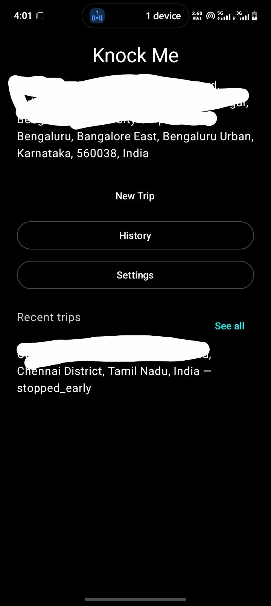
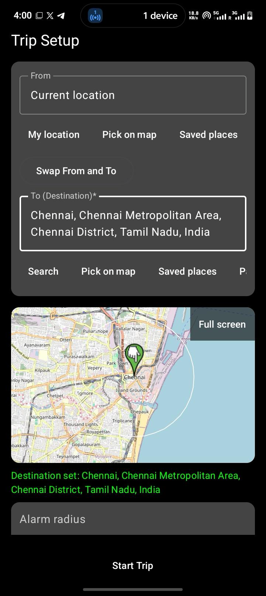
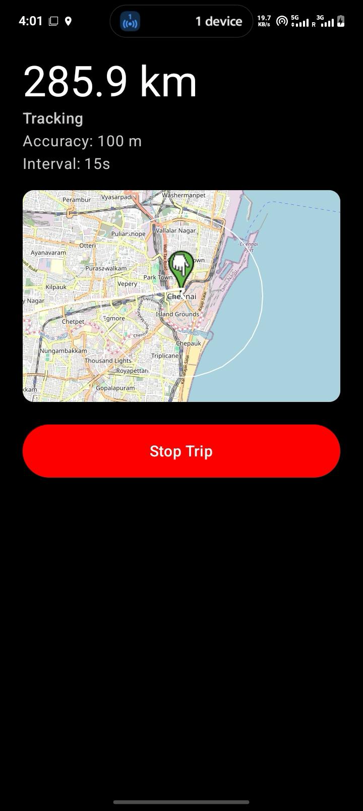
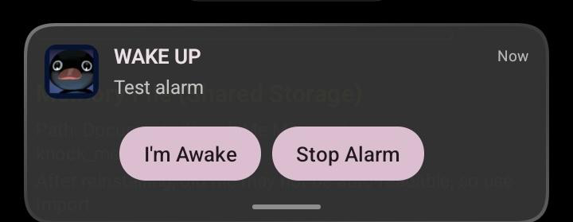

# Knock Me

Knock Me is a travel alarm for people who fall asleep on the road. Set your destination once.
Knock Me watches your GPS in the background and rings loudly when you get close to your stop,
so you never miss it. If your cab leaves the planned route, it rings again, so you can act
before a wrong turn becomes a problem.

I built it for myself. On long trips of 6, 12, even 18 hours, I never knew if I had reached my
stop. On late-night rides, I could not stay awake to watch every turn, and I did not want to
trust a tired or drunk driver blindly. It is especially useful for women travelling alone, and
for anyone who wants to rest without worrying.

No account. No tracking. Everything stays on your phone.

A location alarm that wakes you before your stop and warns you when your ride leaves the route.

## Why I built this

On long rides I get tired and fall asleep. Taxi drivers (Uber, Rapido, etc.) can take a
different road and I do not want to keep checking my screen to make sure they are going the
right way. On long trips of 2, 6, 12, sometimes 18 hours by bus or train, I do not know if I
have reached my stop. Sometimes I sleep through it, sometimes the driver wakes me. I wanted to
be told before I reach my place so I can get ready and get out in time.

## The two problems it solves

- **Arrival alarm** — rings loudly 1 to 5 km before your destination, even with the screen
  locked and the phone on silent.
- **Wrong-route alarm** — rings if your ride goes more than 500 m off the planned route (Cab
  mode), so you know a detour happened without staring at the map.

## Features

- Current location and destination fields, with search, pin-on-map, and paste support.
- Saved places (Home, Office, custom) and recent trips, one tap to reuse.
- Local trip history stored on the device.
- A readable memory file mirrored to `Documents/Knock Me Memory/` for backup/export.
- Battery-friendly adaptive GPS polling (slows down when you're far from the destination).
- Plain black-and-white UI, no clutter.
- Cab and Bus/Train modes.
- One clear Stop button that actually stops everything (alarm, tracking, service).

## Screenshots

<table>
<tr>
<td align="center"><br>Home</td>
<td align="center"><br>Trip Setup</td>
<td align="center"><br>Active Trip</td>
<td align="center"><br>Alarm</td>
</tr>
</table>

## How it works

The app starts a foreground service that tracks your GPS location at an interval that adapts
to how far you are from the destination. It checks your distance against a geofence radius for
the arrival alarm, and (in Cab mode) checks your position against a planned route fetched from
OSRM, raising a wrong-route alarm if you drift more than 500 m off it for several readings in a
row. The alarm uses a full-screen intent so it can wake the screen and ring even when locked.

## Tech stack

- Kotlin, Jetpack Compose
- Fused Location Provider (Google Play services) with a platform-location fallback
- Room (local trip history, saved places)
- DataStore (settings, active trip)
- osmdroid (map tiles), Nominatim (search/geocoding), OSRM (routing)
- No API keys required anywhere.

## Privacy

Everything stays on your phone. No accounts, no analytics, no cloud sync. The only network
calls are to the keyless public Nominatim and OSRM services, used to search for places and
fetch a route — no personal data is sent beyond the coordinates needed for that single request.

## Build and run

1. Install [Android Studio](https://developer.android.com/studio).
2. Open this folder as a project.
3. Plug in a phone with USB debugging enabled, press Run.

Or from the command line:

```
export JAVA_HOME="/Applications/Android Studio.app/Contents/jbr/Contents/Home"
export ANDROID_HOME="$HOME/Library/Android/sdk"
./gradlew assembleDebug
```

APK output: `app/build/outputs/apk/debug/app-debug.apk`

## Permissions and why each is needed

- **Location (fine/coarse)** — required to track your position and detect arrival/off-route.
- **Background location** — the trip keeps tracking while the app isn't on screen.
- **Notifications** — the foreground-service status and the alarm itself are notifications.
- **Full-screen intent / alarm** — lets the alarm wake and show over the lock screen.
- **Battery optimization exemption** — stops Android from killing tracking during a long trip.

## Known limits (honest)

- Cannot read the destination directly from Uber or Rapido — you set it yourself.
- You must start a trip with one tap before it begins tracking.
- The public OSRM server can be slow or rate-limited at times.
- Best tested on a real phone — emulator GPS has to be set manually.
- Some phone brands aggressively kill background apps; battery optimization exemption helps
  but isn't a guarantee on every OEM.

## Roadmap

- Auto-detect which vehicle/app you're riding in.
- Paste and share destinations directly from Google Maps.
- An iPhone version (separate project).
- A better/faster route provider than the public OSRM instance.

## License

MIT — see [LICENSE](LICENSE).
