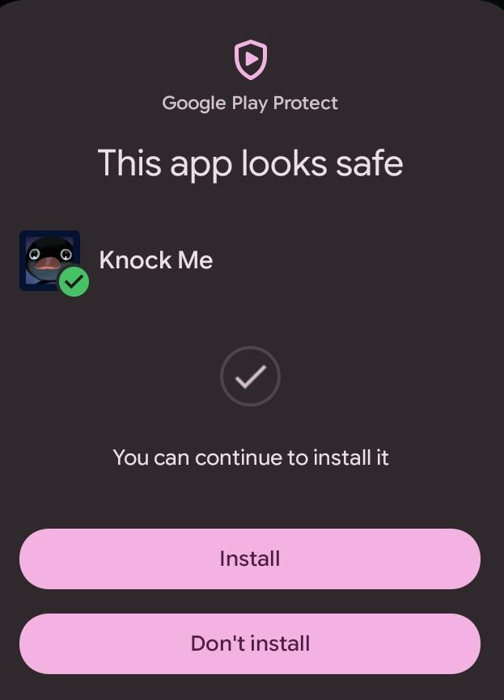
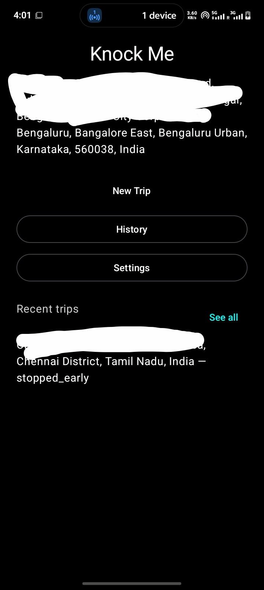
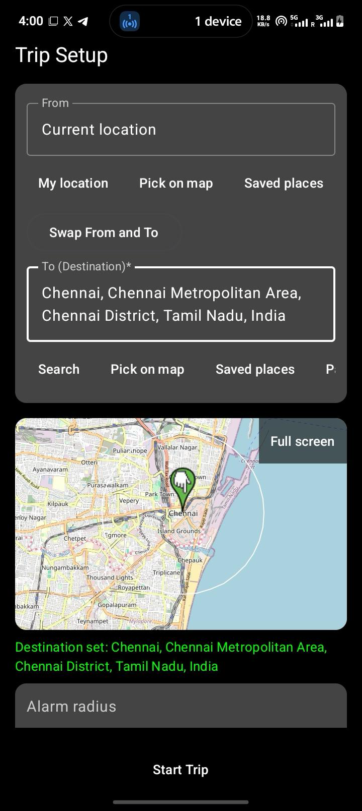
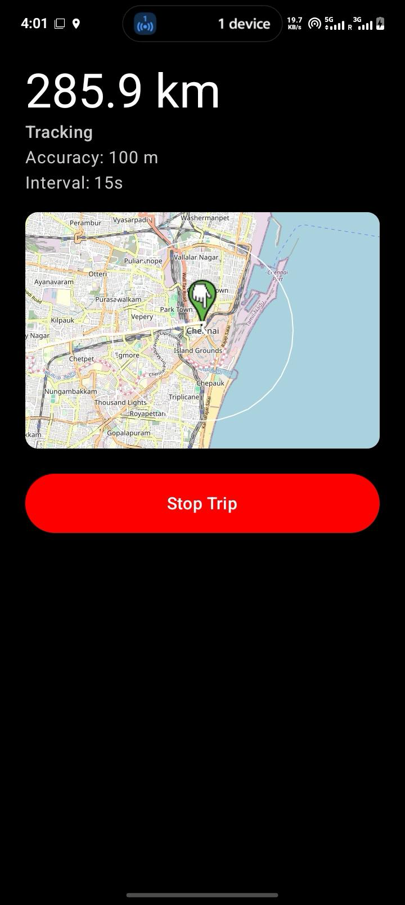
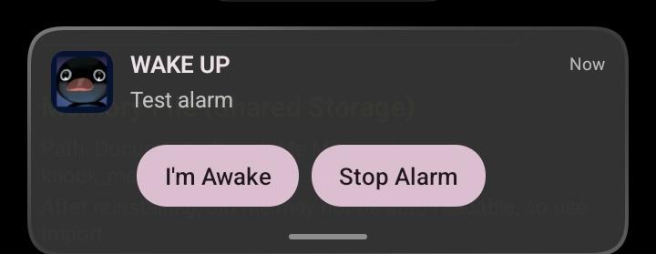

# Knock Me

Knock Me is a travel alarm for people who fall asleep on the road. Set your destination once.
Knock Me watches your GPS in the background and rings loudly when you get close to your stop,
so you never miss it. If your cab leaves the planned route, it rings again, so you can act
before a wrong turn becomes a problem.

I built it for myself. On long trips of 6, 12, even 18 hours, I never knew if I had reached my
stop. On late-night rides, I could not stay awake to watch every turn, and I did not want to
trust a tired or drunk driver blindly. It is especially useful for women travelling alone, and
for anyone who wants to rest without worrying.

No account. No tracking. Everything stays on your phone.

## Download the APK

Just want to use the app? Click **[knockme.apk](knockme.apk)**, download it, open it on your
Android phone, and install it (allow "install from unknown sources" if asked). No Android
Studio needed. *(Updated to v1.5 — Lean mode permissions, watchdog, Max reliability.)*

<p align="center"></p>
<p align="center">Google Play Protect verified APK</p>

A location alarm that wakes you before your stop and warns you when your ride leaves the route.

## Why I built this

On long rides I get tired and fall asleep. Taxi drivers (Uber, Rapido, etc.) can take a
different road and I do not want to keep checking my screen to make sure they are going the
right way. On long trips of 2, 6, 12, sometimes 18 hours by bus or train, I do not know if I
have reached my stop. Sometimes I sleep through it, sometimes the driver wakes me. I wanted to
be told before I reach my place so I can get ready and get out in time.

## The two problems it solves

- **Arrival alarm** — rings loudly 1 to 5 km before your destination, even with the screen
  locked and the phone on silent.
- **Wrong-route alarm** — rings if your ride goes more than 500 m off the planned route (Cab
  mode), so you know a detour happened without staring at the map.

Once you arrive, Knock Me stops tracking on its own — it stops location updates the instant
arrival is confirmed (either the usual 2-reading radius check, or just sitting within 150 m of
the destination for a full minute, which catches a stop that's slightly outside the radius you
picked), and fully cleans everything up (notification, foreground service, geofence, the
background watchdog) once you dismiss the alarm. A trip also ends on its own after a safety-cap
duration (default 36 hours, editable in Settings) so nothing can track forever by mistake.

## Features

- Current location and destination fields, with search, pin-on-map, and paste support.
- No-API-key place search: searches your saved/recent places, Photon, and Nominatim at once,
  sorts the results (your own places first, then nearest to you), and removes duplicates.
- Paste or share a Google Maps link, shared text, a `geo:` link, plain coordinates, or a Plus
  Code (full or short) — Knock Me reads the destination straight out of it.
- Saved places (Home, Office, custom) and recent trips, one tap to reuse.
- Local trip history stored on the device, with a "Clear all history" option in Settings.
- Custom alarm distances — set the main radius and the final alarm down to the exact meter.
- A readable memory file mirrored to `Documents/Knock Me Memory/` for backup/export.
- Battery-friendly adaptive GPS polling (slows down when you're far from the destination).
- Lean permissions by default, with an optional Max reliability mode and a watchdog that alerts
  you if tracking ever actually stops.
- Plain black-and-white UI, no clutter.
- Cab and Bus/Train modes.
- One clear Stop button that actually stops everything (alarm, tracking, service).

## Screenshots

<table>
<tr>
<td align="center"><br>Home</td>
<td align="center"><br>Trip Setup</td>
<td align="center"><br>Active Trip</td>
<td align="center"><br>Alarm</td>
</tr>
</table>

## How it works

The app starts a foreground service that tracks your GPS location at an interval that adapts
to how far you are from the destination. It checks your distance against a geofence radius for
the arrival alarm, and (in Cab mode) checks your position against a planned route fetched from
OSRM, raising a wrong-route alarm if you drift more than 500 m off it for several readings in a
row. The alarm uses a full-screen intent so it can wake the screen and ring even when locked.

## Tech stack

- Kotlin, Jetpack Compose
- Fused Location Provider (Google Play services) with a platform-location fallback
- Room (local trip history, saved places)
- DataStore (settings, active trip)
- osmdroid (map tiles), Photon and Nominatim (search/geocoding), OSRM (routing)
- No API keys required anywhere.

## Privacy

Everything stays on your phone. No accounts, no analytics, no cloud sync. The only network
calls are to the keyless public Photon, Nominatim, and OSRM services, used to search for places
and fetch a route — no personal data is sent beyond the coordinates needed for that request.

## Permissions: Lean mode vs Max reliability

By default (Lean mode) a fresh install asks for only two things:

- **Location, while you use Knock Me** — needed to know where you are.
- **Notifications** — needed to show your trip and ring the alarm.

That's enough for tracking to keep working with the screen locked, the same way Google Maps
navigation does — Android allows a running foreground location service to keep getting fixes
without the broader "Allow all the time" permission. A third permission, **alarms over the lock
screen**, is only asked (once, skippable) right before your first trip, and only on Android
versions that require it.

If your phone is known to be aggressive about killing background apps, Settings → Reliability
has an optional **Max reliability** switch. Turning it on asks for two more things:

- **Location, all the time** — so a geofence backup can also catch arrival if the main
  tracking loop ever gets interrupted.
- **Ignore battery limits** — stops the system from pausing Knock Me during a long trip.

Max reliability also enables resuming your trip automatically after a phone reboot, and shows
brand-specific steps (Xiaomi, Oppo, Realme, Vivo, OnePlus, Samsung, Huawei, Honor) for turning
off that manufacturer's own background-app killer. Knock Me will also show a one-time card on
Home — only after it actually detects a trip got interrupted — suggesting you turn this on.

## Known limits (honest)

- Cannot read the destination directly from Uber or Rapido — you set it yourself.
- You must start a trip with one tap before it begins tracking.
- The public OSRM server can be slow or rate-limited at times.
- Best tested on a real phone — emulator GPS has to be set manually.
- Some phone brands aggressively kill background apps; battery optimization exemption helps
  but isn't a guarantee on every OEM.

## Roadmap

- Auto-detect which vehicle/app you're riding in.
- Paste and share destinations directly from Google Maps.
- An iPhone version (separate project).
- A better/faster route provider than the public OSRM instance.

## License

MIT — see [LICENSE](LICENSE).

## Build and run (developers)

Want to build it yourself instead of using the APK above?

1. Install [Android Studio](https://developer.android.com/studio).
2. Open this folder as a project.
3. Plug in a phone with USB debugging enabled, press Run.

Or from the command line:

```
export JAVA_HOME="/Applications/Android Studio.app/Contents/jbr/Contents/Home"
export ANDROID_HOME="$HOME/Library/Android/sdk"
./gradlew assembleDebug
```

APK output: `app/build/outputs/apk/debug/app-debug.apk`

## Release

The project is set up so a signed release build works without any code changes once you provide
a keystore:

1. Copy `keystore.properties.example` to `keystore.properties` (project root) and fill it in.
   This file is git-ignored — never commit it.
2. Set `APP_VERSION_CODE`/`APP_VERSION_NAME` in `gradle.properties`.
3. `./gradlew bundleRelease` (produces `app/build/outputs/bundle/release/app-release.aab`).

See `store/release-checklist.md` for the full walkthrough (keystore creation, Play Console
testing tracks, the third-party-server scaling risk and options), `store/data-safety.md` and
`store/permissions-justification.md` for drafted Play Console form answers, and `PRIVACY.md` for
the full privacy policy. `./scripts/verify_release.sh` runs lint, unit tests, a release
compile/R8 check, and a forbidden-permissions scan, and prints PASS/FAIL.
